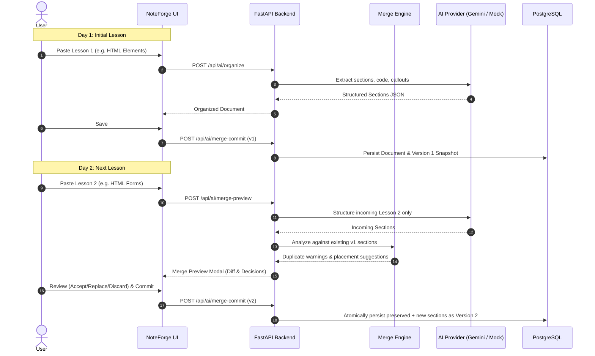

# NoteForge AI — AI Structuring & Continuous Merge Pipeline

## Overview
NoteForge AI transforms messy educational content into clean, readable, technically accurate study notes. Unlike naive AI wrappers that overwrite an entire document whenever new content is provided, NoteForge AI implements a continuous section-level merge engine that protects previously learned material.

---

## The Continuous Document Workflow

---

## Merge Engine Algorithms

### 1. Stable Key Generation & Semantic Matching
Each incoming section receives a normalized slug:
$$\text{slug} = \text{regex\_replace}(\text{"[^a-zA-Z0-9\_]+"}, \text{"\_"}, \text{title.lower()})$$

### 2. Weighted Similarity Metric
To catch duplicates without discarding valid updates, the engine computes:
$$\text{Similarity} = 0.5 \times \text{TitleSimilarity} + 0.5 \times \text{JaccardTokens}(\text{Body}_1, \text{Body}_2)$$

- **$\text{Similarity} \ge 0.70$**: Flagged as `duplicate` with prominent amber/red badge and side-by-side comparison.
- **$0.35 \le \text{Similarity} < 0.70$**: Flagged as `partial_update` (topical overlap) with placement after the matched topic.
- **$\text{Similarity} < 0.35$**: Marked as `new` topic and appended to the section progression.

### 3. Source Preservation Mode
When `preserve_source` is enabled:
- Verbatim source code, whitespace, punctuation, and phrasing are preserved in `raw_source`.
- AI enhancements are constrained to typographic formatting, syntax language labeling, and callout highlighting.
